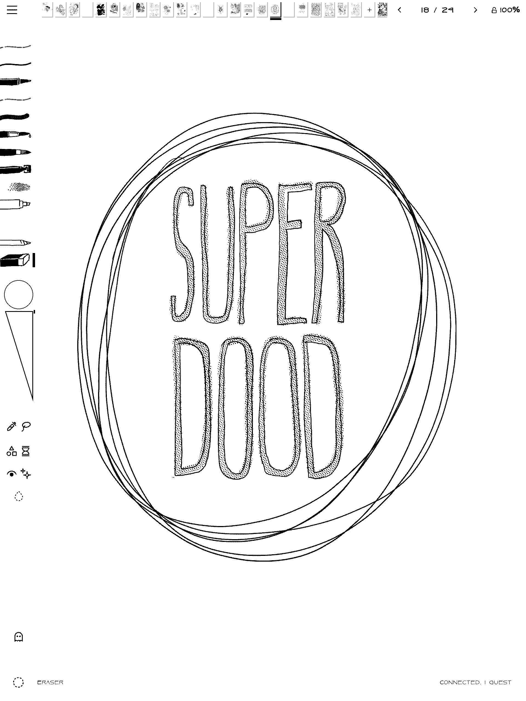

# Superdood



A sketchbook journal thing for the Supernote Manta e-ink tablet, with notebooks to fill with handwriting, drawing and doodling, and a set of tools that are useful, and sometimes (delightfully?) unpredictable.

On the web at [superdood.org](https://superdood.org): [Draw Together](https://superdood.org/live/) and
[Brush Studio](https://superdood.org/studio/).

## Built on MonoPaint

This app is a fork of the wonderful [MonoPaint](https://github.com/mpdairy/monopaint) by mpdairy. Its fast e-ink pen
path, documents, layers and wet media are MonoPaint's work, and the fork keeps MonoPaint's MIT notice
([LICENSE](LICENSE)). If you want a full painting app, use MonoPaint! 

## About Superdood

- **Notebooks** on a shelf, up to 250 pages each, with covers, templates and a possibility of adding unusual constraints, like no erasing, one brush,
  and timed pages. Saved as you go on the tablet, with no account. The app goes online only when you ask it to: for
  Draw Together, for Export Page's Send, and when you send a page to the Fridge.
- **[The Fridge](https://superdood.org/fridge)**: Menu, Send to the Fridge pins the page you're on (a PNG, with an
  optional name and caption) to the shared fridge door once I approve it, and/or to your own unlisted page at once.
  Nothing else is sent, and you can take any page down again from the tablet.
- **Read Handwriting** (off until you turn it on in System Settings) lets the shelf's Search find words in your pen
  writing. It uses Google's ML Kit (closed source), downloaded only when you switch it on. The writing stays on the
  tablet; Google gets usage stats, never the writing. Notebook PDFs then carry each line's best reading as hidden text.
- **A brush engine**: every brush is built using six modules -- Tip, Medium, Smudge, Paper, Drying, and Control -- and can generate a short
  share code. There are nine tool slots on the side bar and a library of brushes (some pens, pencils, markers, charcoal, ink wash,
  watercolour, gouache, oils) and you can tweak them in app in the **Brush Lab** (hold a slot, Edit Brush).
- **[Brush Studio](https://superdood.org/studio/)** is a web brush making companion that reads and writes the same codes.
- **[Draw Together](https://superdood.org/live/)**: share a page from the tablet and draw on it together from a browser.
- **Some Mischief**: I played around with weird ideas, like ink that fades or appears later (Fading, Lemon Juice), Mold growing on paint, momentum mark finishes, Spirograph, Stamp, mirrors on the canvas and fridge-magnet words.

Whatever is new will be in [CHANGELOG.md](CHANGELOG.md); a tour of the screens is in [docs/TOOLS.md](docs/TOOLS.md).

## Install

### From a release (about 5 minutes, no coding)

1. **Download** `superdood-1.2.1.apk` from the [latest release](https://github.com/ellinglien/superdood/releases/latest).
2. **On the Supernote:** Settings → Security & Privacy → turn on **Sideloading**.
3. **On your computer** (Mac, Windows or Linux): install
   [Android Sideloader](https://github.com/ryan-andrew/android_sideloader/releases). Plug the Supernote in with its USB
   cable, open Android Sideloader, click **Choose APK file**, pick the `.apk`, then **Install APK**.
4. **On the Supernote:** open **Superdood** and allow file access when it asks: notebooks live in
   `Document/Superdood`, where they survive updates and reinstalls (and can sync).

### Or with adb

With Google's [platform tools](https://developer.android.com/tools/releases/platform-tools) on your computer and the
Supernote connected by USB (`adb devices` should list it):

```sh
adb install -r superdood-1.2.1.apk     # the .apk you downloaded
adb shell cmd package compile -m speed -f ing.ell.mybaddrawings     # optional: compiles it ahead of time
```

Later releases install over it either way; your notebooks are kept.

### From source

Details in [docs/BUILDING.md](docs/BUILDING.md):

1. Install [Android Studio](https://developer.android.com/studio) (for JDK 21 and the Android SDK), then in its SDK
   Manager add Android 14 (API 34), NDK 27.0.12077973 and CMake 3.22.1.
2. On the tablet, turn on Sideloading in its settings, and connect it by USB (`adb devices` should list it).
3. In this folder:

   ```sh
   export JAVA_HOME="/Applications/Android Studio.app/Contents/jbr/Contents/Home"   # macOS; elsewhere, Studio's jbr
   export ANDROID_HOME="$HOME/Library/Android/sdk"                                  # where the SDK Manager put it
   ./gradlew :app:assembleRelease
   adb install -r app/build/outputs/apk/release/app-release.apk
   adb shell cmd package compile -m speed -f ing.ell.mybaddrawings
   ```

   The last line compiles the app ahead of time, which keeps drawing smooth on the tablet. Without a release key
   of your own the build is signed with Android's debug key; that's fine for your own tablet.
4. Open Superdood and allow file access when it asks: notebooks live in `Document/Superdood`.

It's only been tested on the Supernote Manta, but I tried to build it with the Nomad in mind as well: its layouts
were made for the Nomad's screen too, just never tried on one, so expect rough edges there (reports welcome). Other
Android tablets are untested.

## Made with AI

This app was built with AI: the code is AI-generated (Anthropic's Claude, through Claude Code), directed, tried on
the tablet and shaped by me. See [AI_DISCLOSURE.md](AI_DISCLOSURE.md).

## Development

`bash scripts/test_inkwash.sh` runs the desktop checks (JDK and Node.js). See [CONTRIBUTING.md](CONTRIBUTING.md),
[docs/ARCHITECTURE.md](docs/ARCHITECTURE.md) for the code, and [docs/INTEGRATION.md](docs/INTEGRATION.md) for what
differs from MonoPaint.

## Licence

[MIT](LICENSE), © mpdairy (MonoPaint) and Elling Lien (the fork). Fonts, icons, paper textures and the pen bridge
come from others under their own terms: see [THIRD_PARTY_NOTICES.md](THIRD_PARTY_NOTICES.md).
