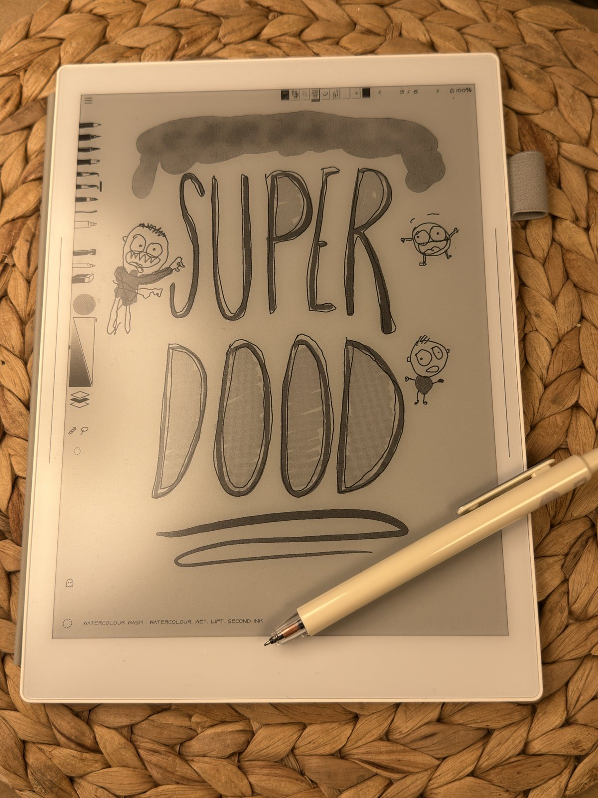

# Superdood



A sketchbook journal thing for the Supernote Manta e-ink tablet, with a set of tools that are useful and occasionally unpredictable.

Website: [superdood.org](https://superdood.org)

## Built on MonoPaint

This app is a fork of the wonderful [MonoPaint](https://github.com/mpdairy/monopaint) by mpdairy. Its fast e-ink pen
path, documents, layers and wet media are all his work. If you want a full painting app, definitely use MonoPaint!

## About Superdood

- Things are stored in **Notebooks**. They can be up to 250 pages each and everything saves automatically.
- **A brush engine**: Under the hood there's a full modular brush building system. Each brush consists of six customizable elements: Control, Tip, Medium, Affects Page, Drying and After. There are nine tool slots on the side bar and a library of preset brushes (some pens, pencils, markers, charcoal, ink wash, watercolour, gouache, oils) which you can tweak in the app.
- **[Brush Studio](https://superdood.org/studio/)** is a web brush making companion that reads and writes the same codes. 

- **[The Fridge](https://superdood.org/fridge)**: Menu, Send to the Fridge pins the page you're on (a PNG, with an
  optional name and caption) to the shared fridge door once I approve it, and/or to your own unlisted page at once.
  Nothing else is sent, and you can take any page down again from the tablet.
- **Second Ink**: Because it's on the Supernote of course everything is monochrome in the app, but some tools like washes are switched to a second ink colour in exports to give things automatically a bit more life.
- **[Draw Together](https://superdood.org/live/)** allows you to share a page with someone and draw at the same time.

A tour of the screens, with screenshots, is in [docs/TOOLS.md](docs/TOOLS.md).

## How to Install

### From a release it takes about 5 minutes and no coding

1. **Download** `superdood-1.2.4.apk` from the [latest release](https://github.com/ellinglien/superdood/releases/latest).
2. **On the Supernote:** Settings → Security & Privacy → turn on **Sideloading**.
3. **On your computer** (Mac, Windows or Linux): install
   [Android Sideloader](https://github.com/ryan-andrew/android_sideloader/releases). Plug the Supernote in with its USB
   cable, open Android Sideloader, click **Choose APK file**, pick the `.apk`, then **Install APK**.
4. **On the Supernote:** open **Superdood** and allow file access when it asks: notebooks live in
   `Document/Superdood`, where they survive updates and reinstalls (and can sync).

### From source

Details in [docs/BUILDING.md](docs/BUILDING.md):

1. Install [Android Studio](https://developer.android.com/studio) (for JDK 21 and the Android SDK), then in its SDK
   Manager add Android 14 (API 34), NDK 27.0.12077973 and CMake 3.22.1.
2. On the tablet, turn on Sideloading in its settings, and connect it by USB (`adb devices` should list it).
3. In this folder:

   ```sh
   export JAVA_HOME="/Applications/Android Studio.app/Contents/jbr/Contents/Home"   # macOS; elsewhere, Studio's jbr
   export ANDROID_HOME="$HOME/Library/Android/sdk"                                  # where the SDK Manager put it
   ./gradlew :app:assembleRelease
   adb install -r app/build/outputs/apk/release/app-release.apk
   adb shell cmd package compile -m speed -f ing.ell.mybaddrawings
   ```

   The last line compiles the app ahead of time, which keeps drawing smooth on the tablet. Without a release key
   of your own the build is signed with Android's debug key; that's fine for your own tablet.
4. Open Superdood and allow file access when it asks: notebooks live in `Document/Superdood`.

It's only been tested on the Supernote Manta, but I tried to build it with the Nomad in mind as well: its layouts
were made for the Nomad's screen too, just never tried on one, so expect rough edges there (reports welcome!). Other
Android tablets are untested.

## Made with AI

This app was built with AI: the code is AI-generated (Anthropic's Claude, through Claude Code), directed, tried on
the tablet and shaped by me. See [AI_DISCLOSURE.md](AI_DISCLOSURE.md).

## Development

`bash scripts/test_inkwash.sh` runs the desktop checks (JDK and Node.js). See [CONTRIBUTING.md](CONTRIBUTING.md),
[docs/ARCHITECTURE.md](docs/ARCHITECTURE.md) for the code, and [docs/INTEGRATION.md](docs/INTEGRATION.md) for what
differs from MonoPaint.
