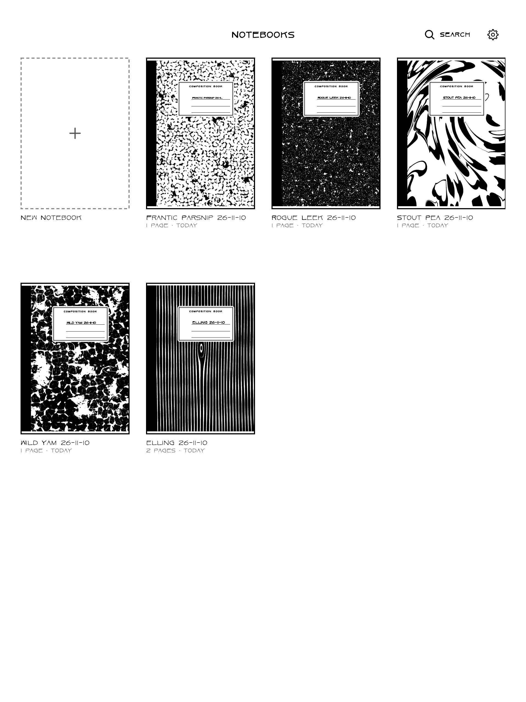
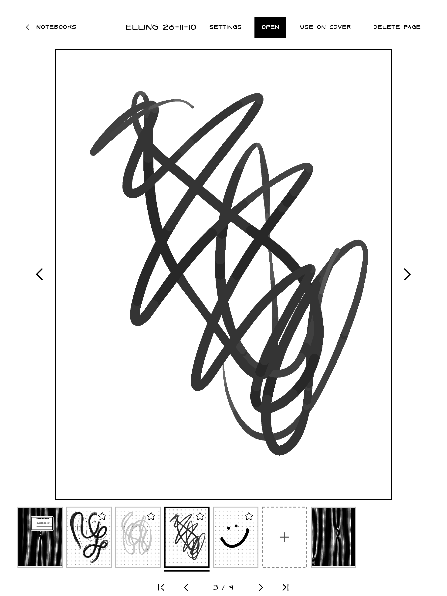
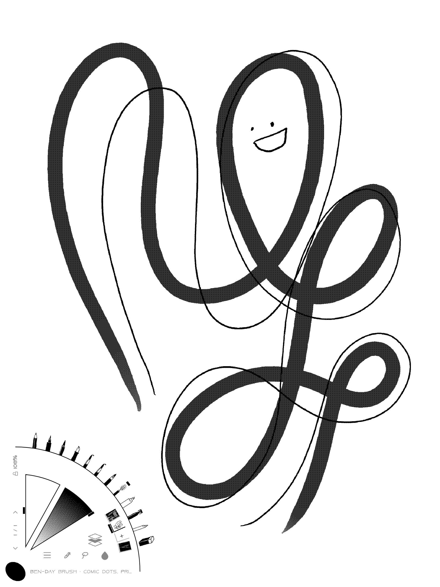
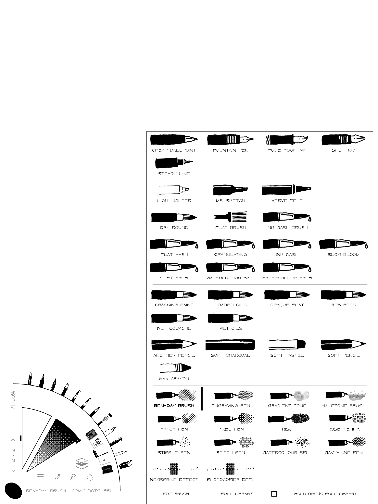
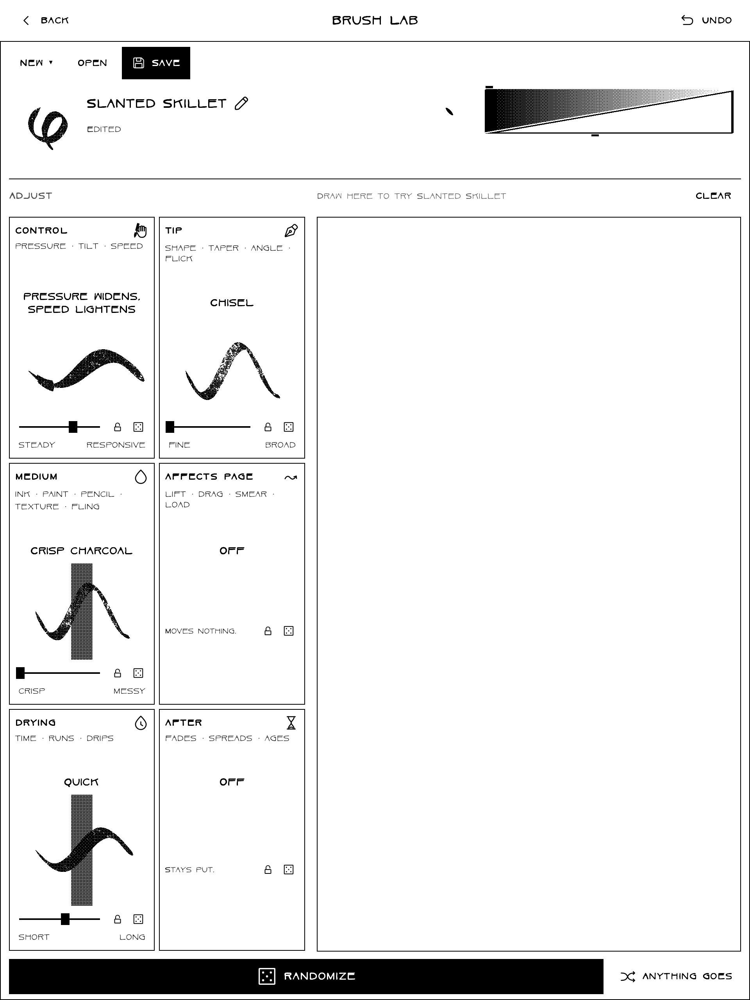

# A tour of Superdood

A short map of the screens. The full story of each tool, and why it works the way it does, is in
[CHANGELOG.md](../CHANGELOG.md) and [DESIGN.md](DESIGN.md).

## The shelf and notebooks

 

The app opens on the notebook you were last in; the shelf shows the rest. A notebook has up to 250 pages and its
own settings: a page template (or one of the tablet's own templates), which tools it keeps, rules such as No
Erasing, One Brush and Timed Pages, and a cover design.
Notebooks are saved as you draw, in `Document/Superdood` on the tablet; PNG and PDF copies are made only when
you ask (Export). The copies are grey, as the tablet is, but for what a Second Ink brush drew: that shows in the
notebook's Second Ink (Notebook Settings: Blue, Sepia, Red, Green, Violet), there and on the Fridge.

The shelf holds a notebook named **#inktober52**, the Prompts notebook. Opened the first time, it asks to turn on,
since it uses the internet. Then it adds a page a week, the #inktober52 word, its number and its week across its top.
**Send to the Fridge** (the menu) sends any page to superdood.org/fridge, a prompt page under its word; the first time, it confirms your email.
**Stop Taking Part**, in its Notebook Settings, deletes your email and your pages on the Fridge; the notebook stays.

## The drawing screen

- **Zen Mode and the fan**: the app opens in Zen Mode with the fan open, a quarter circle from the corner. Along its side
  edge two wedges set the size and the grey. Past them a ring of page previews (the page drawn on has a tab; + adds a
  page). On the arc stand the tools: nine brush slots, Fill in, the smudge tool and the eraser. Along the foot are Menu,
  the Dropper, Lasso, the droplet and the layer button; up its left edge are ‹, the page and its count, › and Zoom.
  Tap picks (a tool, a page, a size or grey); hold opens its menus: a slot's brushes (or **Edit Brush**, which opens
  Brush Lab on it), a page's settings. Picking keeps the fan open. The circle in the corner closes the fan; hold it
  to leave Zen Mode.
- **The side bar and page bar**: out of Zen Mode, the side bar holds Menu, the nine slots, the smudge tool and the eraser, a
  box for the size and grey of the tool in hand, and a few small buttons (Play, the timer, show or hide each kind of
  mark), used the same way. The page bar, along the top, has the notebook, Zoom and the page count, which opens the
  page previews.
- **Fingers**: one finger does what the menu's Finger Action row says (Eraser, Smudge, a brush, Turn pages, or Nothing; Turn pages turns the page with a swipe left or right); two fingers tap to undo,
  three to redo; with Zoom unlocked, two fingers pinch and pan; locked, they still pan (sideways a page is taller than the screen), never zoom.
- **Play** opens the mischief: Text, Magnetic Poetry (fridge-poetry words), Shapes, Spirograph, Mirrors that copy
  each stroke, and **Replay Page**, which draws a page again, stroke by stroke.
- **Lasso** picks up part of a page to move, size or turn; **Import** places a picture or a PDF page.

## Brushes

 

Every brush is built from its parts (Control, Tip, Medium, Affects Page, Drying and After; the paper is the notebook's Surface), each with a few dials, and saved as
a short share code. The **Tools page** is the library: ready brushes grouped by what they do (Pens, Markers, Brushes,
Washes, Paint, Dry Media, Print, Odd Ones) and your own: tap a slot, then a brush for it. Tapping the selected slot
again picks it up, and a tap on another slot swaps the two, with their sizes and greys (the toolbar's order). **Brush Lab** (a slot's long press, Edit Brush) makes
and changes them, with a test page beside the dials; its Medium part's **Second Ink** dial (Off, On; Ink, Wash, Opaque, Charcoal and Graphite) marks a brush whose paint copies show in the notebook's second ink. About half of the Basic washes and paints come with it On (Ink wash and Watercolour wash among them), and two pens, Hatch pen and Fountain pen. The two inks blend where they meet, by how dark each is, and paint keeps its ink wherever it goes: a wet wash running or drying, a smudge, the Lasso, a merged layer, a mark that changes later; shapes and fills take their brush's ink, and pictures are first ink. A few brushes are deliberately unpredictable: Vanishing ink and Lemon juice (ink that
fades, or appears minutes later), Mold, Flick and Fling, Spirograph, Stamp and Crayon. They say what they do, and
the plain pens never surprise you.

[Brush Studio](https://superdood.org/studio/) (source in `brush-lab/studio-src`) reads and writes the same share
codes on a computer, and exports brush sets for Procreate.

## Wet media

Washes and watercolour stay wet for a few seconds, then set. With gravity on, wet paint runs toward whichever edge
of the tablet is tipped down. Hold the eraser to choose what it takes: Everything, or only Layer 1, 2
or 3.
